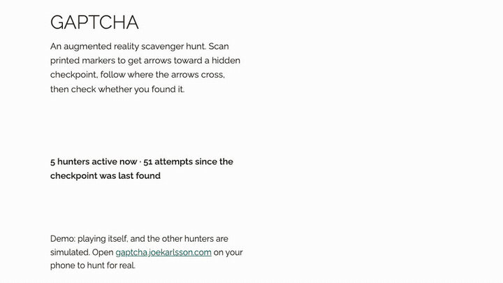
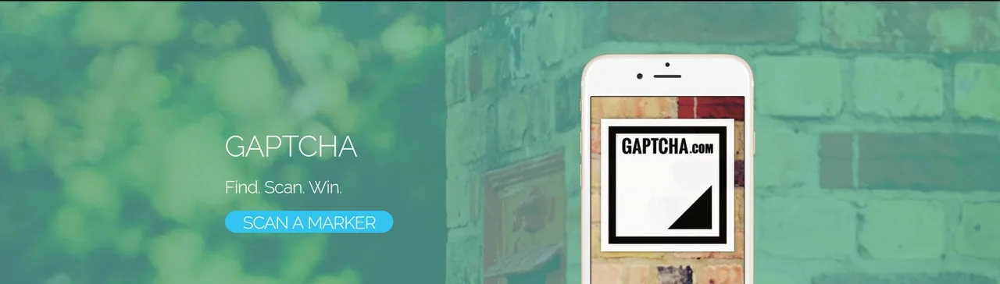
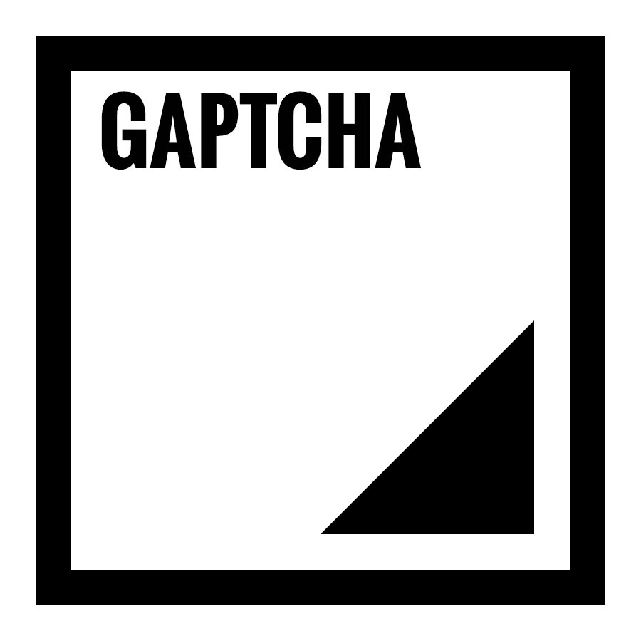
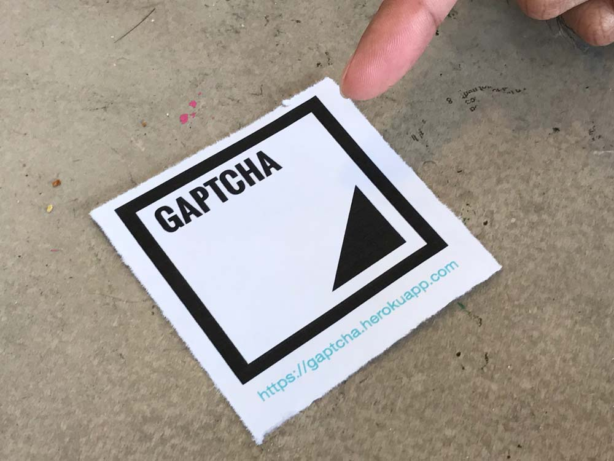
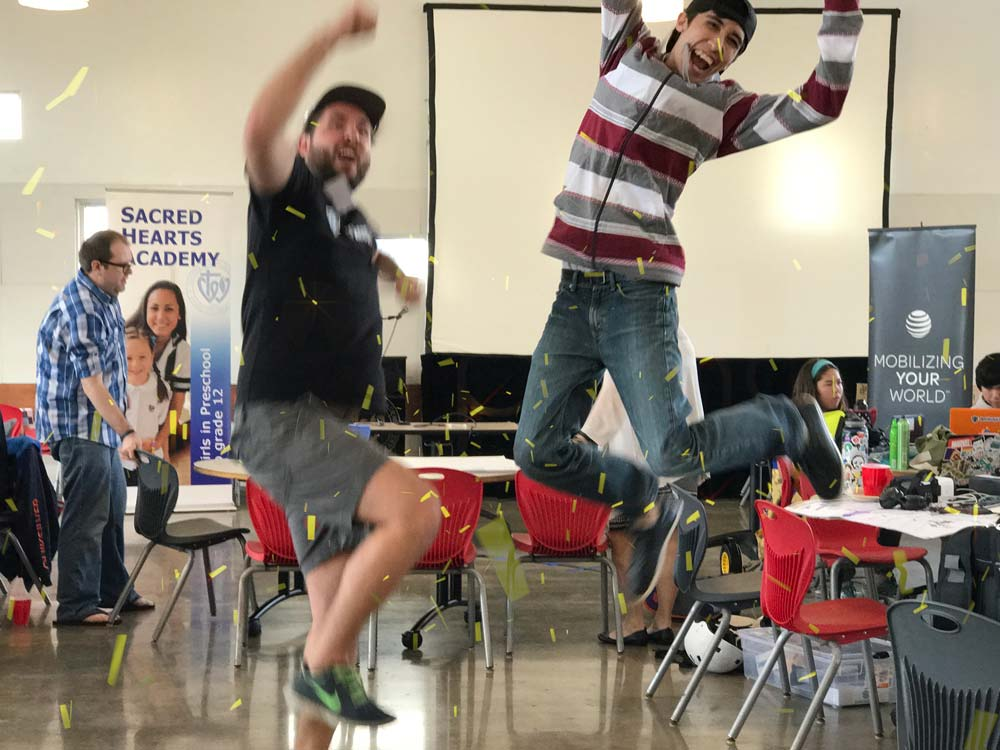

# GAPTCHA

> Geo-Augmented Place That Checks Authenticity

An augmented reality scavenger hunt. Play it at **https://gaptcha.joekarlsson.com**.

More about it, with how it works, on [its page on joekarlsson.com](https://www.joekarlsson.com/work/gaptcha/).



What GAPTCHA looked like in November 2026, recorded for [its page on joekarlsson.com](https://www.joekarlsson.com/work/gaptcha/). The full-quality video is [2026-11-recording.mp4](.github/readme/2026-11-recording.mp4).





## How it works

1. Print the [marker](public/img/marker-gaptcha.png) and stick it somewhere, printed name on top and facing north.
2. Open the site on your phone and tap **Scan a marker**. When the camera sees the marker, an arrow appears on it pointing toward the hidden checkpoint.
3. Scan from a few places and follow where the arrows cross.
4. When you think you're there, tap **Did I win?** You need to be within 20 meters.

The original checkpoint is the Sacred Hearts cafeteria in Honolulu, where we built this for the 2017 AT&T hackathon. Anywhere more than 5 km from it, GAPTCHA hides a demo checkpoint 100 to 300 meters from you on your first scan, and keeps it until you find it or tap **Start a new hunt**.

### Other hunters are simulated

There's no server, so the other players are made up. `public/js/simulated-players.js` invents a hunter scanning a marker somewhere 60 to 600 meters from your checkpoint every 5 to 25 seconds. It also keeps a shared attempt counter that your own scans add to, and once in a while a simulated hunter finds the checkpoint and the count starts over. Their scans show up in the feed on the play page and as white dots on the map. The page says they're simulated. Add `?simulate=fast` to a URL to speed the feed up for testing.

### Embedded demo

Inside an iframe (or with `?embed` in the URL), the home page swaps itself for a demo that plays on its own: a hunter near the original Honolulu checkpoint scans three markers, follows where the arrows cross, misses once, wins, and starts over, next to the simulated hunters feed. It never asks for location or the camera, and it keeps everything in memory, so it can't touch a real player's saved hunt. `public/js/embed-flag.js` turns it on before the page paints; the hunt itself is `public/js/demo-steps.js` (deterministic, unit-tested) and `public/js/embed-demo.js`. Links to the game open the real site in a new tab.

## At the 2017 hackathon






## What changed in 2026

The 2017 version ran on Express and stored the checkpoint and every scan in AT&T M2X, which shut down in 2021. It's now a static site:

- `public/js/checkpoint.js` replaces the old `/api/checkpoint` routes in the browser: bearing and distance math, the hidden checkpoint, attempt counts and scan history, all in `localStorage`.
- The "live feed" map now shows your own scans (Leaflet with OpenStreetMap tiles).
- AR runs on A-Frame 1.7.1 and AR.js 3.4.8 from jsDelivr (pinned, with SRI), instead of the vendored 2017 builds. The arrow is built from A-Frame shapes instead of a PLY model.

## Develop

```bash
npm install
npm run serve        # http://localhost:4791
npm test             # unit tests for the bearing/distance math
npx playwright test  # e2e, axe, layout and metadata tests; includes a fake-camera AR test
node scripts/render-og.mjs  # redraws the 1200x630 share card, public/img/og.png
```

After changing the share card, bump the `?v=` on the `og:image` URLs so networks fetch the new one.

Pushing to `master` runs the tests, builds `dist/` with `node scripts/build.mjs` (a copy of `public/` where every local CSS and JS URL carries a content hash, so a deploy never serves new HTML with a stale cached script), and deploys `dist/` to GitHub Pages.

## Credits

Built at DevLeague by [Joe Karlsson](https://github.com/JoeKarlsson/), [Sean Nakamura](https://github.com/senakamura/), [Tony Gaskell](https://github.com/thgaskell/), [Brandon Baris](https://github.com/brandonbaris/) and [Joelle Torneros](https://github.com/jmt75200/). Forked from [thgaskell/GAPTCHA](https://github.com/thgaskell/GAPTCHA).
